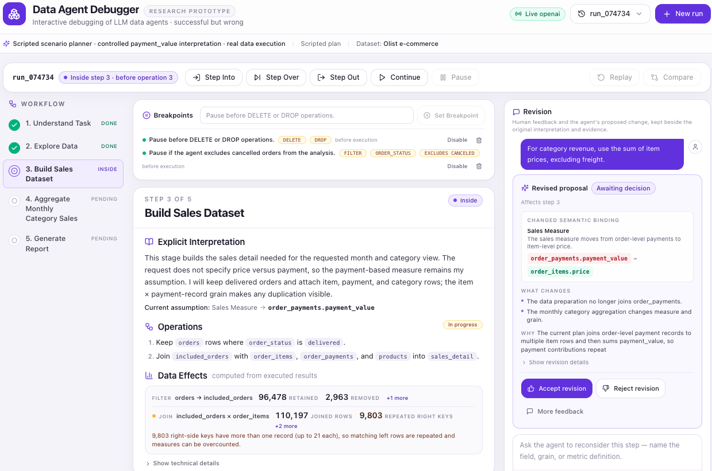
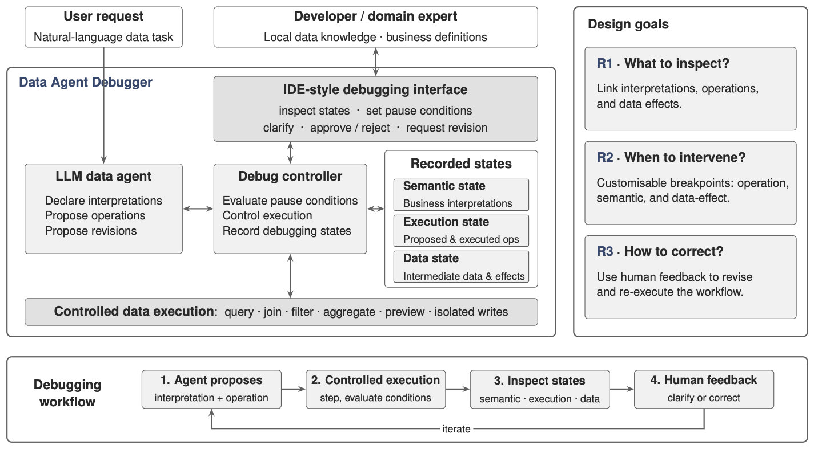

# DataStepper_PoC

DataStepper_PoC is the proof-of-concept implementation of **Data Agent
Debugger**, a research prototype for debugging LLM data agents that execute
successfully but produce semantically wrong results. It shows the agent's
declared interpretation, its operations, and the observed data effects side by
side, and lets developers pause before risky actions, give natural-language
feedback, review a revised plan, and replay the affected work without changing
the original run. Destructive writes only touch a disposable per-run SQLite
copy — there is no production database access.





## Run it

Requirements: Python 3.11+, Node.js 20+, and the six Olist CSVs in `data/olist/`.

```bash
python3 -m venv .venv
.venv/bin/python -m pip install -r backend/requirements.txt
cd frontend && npm install && npm run build && cd ..

python scripts/prepare_data.py --source /path/to/extracted/olist
./scripts/start.sh
```

Open http://127.0.0.1:8000.

For a quick test with a 10-order sample, generate it once from the full CSVs:

```bash
make mini-data
OLIST_DATA_DIR=./data/olist_mini RUNS_DIR=./runs_mini PORT=8001 ./scripts/start.sh
```

Then open http://127.0.0.1:8001. If `data/olist_mini/` already contains the
sample in your working copy, you can run only the second command.

Live mode needs an API key in `.env` (see `.env.example`); Scripted mode works
without one.

## How to use it

1. Click **New run**, choose a prepared scenario, and click **Create run**.
2. Use **Step Into**, **Step Over**, **Continue**, and **Pause** to control
   execution.
3. Select a step to inspect its interpretation, operations, and observed data
   effects.
4. Send feedback in **Human Feedback**, review the proposal, and **Accept
   revision**. If earlier work was already executed, use **Replay** and
   **Compare**.
5. Add a breakpoint in the **Breakpoints** strip, for example:
   - `Pause before DELETE or DROP operations.`
   - `Pause if the agent excludes cancelled orders from the analysis.`
